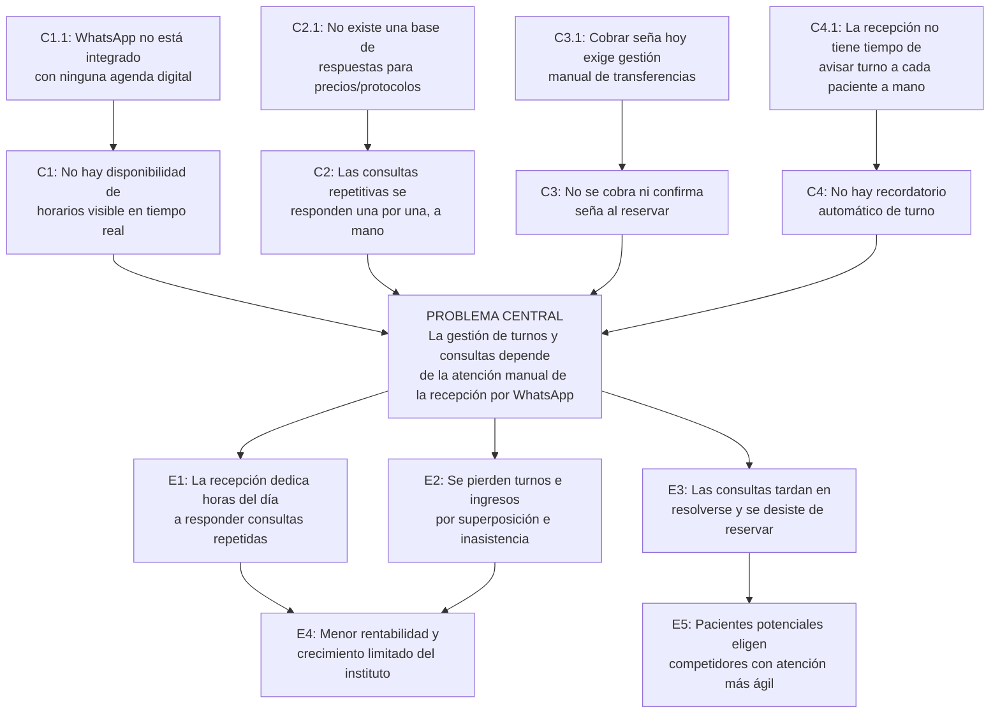

# Árbol de Problemas

Diagnóstico de la problemática elegida: Propuesta 1, sistema de escritorio
para un instituto de estética médica (ver `docs/propuestas.md`,
comparación de las cinco propuestas en carrera).

## Contexto y actores

La problemática es la gestión de turnos y consultas de Dermalia, Instituto
de Estética Médica, barrio de Flores, CABA, a 2026.

Grupos a considerar (según la cátedra, no alcanza con pensar solo desde el
equipo, aunque acá se imaginan en vez de relevarse):

- Beneficiarios directos: el instituto y su equipo de recepción (menos
  carga operativa, menos horas perdidas en WhatsApp).
- Beneficiarios indirectos: pacientes actuales y potenciales (turnos
  confirmados sin demoras, menos reprogramaciones por superposición).
- Posibles detractores: pacientes habituales acostumbradas al trato
  directo por WhatsApp, que podrían resistirse a que se les pida una seña
  formal al reservar (riesgo ya anotado en `propuestas.md`).
- Ejecutores: el equipo del proyecto.

## Problema central

La gestión de turnos y consultas de Dermalia depende de la atención manual
de la recepción por WhatsApp, lo que consume horas de trabajo, produce
superposiciones y turnos perdidos, y demora las respuestas a quienes
consultan (Dermalia, barrio de Flores, CABA, a 2026).

No es "no hay una app de turnos" (el error más común al formular esta
etapa): es la carga de trabajo y la pérdida de turnos que ya existen hoy,
con o sin sistema.

## Diagrama

El diagrama de arriba es la versión formalizada (C1-C4, Dermalia). El
árbol también se armó antes, como post-its en el board de Miro "Proyecto
informático 1", en la etapa de brainstorm inicial, con el negocio y el
lenguaje de esa etapa (Bella Piel, "el dueño", "clientas"), sin la
distinción causa directa / causa raíz todavía. Con más de 15 post-its
alrededor de un solo nodo central, un flowchart de Mermaid lo dibuja como
una estrella radial ilegible, así que se deja como tabla en vez de
diagrama:

**Problema (brainstorm)**: "Mejorar la atención al cliente, aliviar la
carga para el dueño y generar más alcance para el negocio."

| Causas (post-its) | Efectos (post-its) |
|---|---|
| No hay un sistema de reservas con horarios visibles | Menor rentabilidad y crecimiento limitado del negocio |
| Atención manual por el dueño mediante WhatsApp | Pérdida de tiempo que podría dedicarse a atender clientas |
| Cantidad de tiempo que toma contestar mensajes | El dueño no puede enfocarse en el servicio |
| Sin disponibilidad 24/7 | Clientes potenciales eligen negocios con atención más ágil |
| No se cobra ni confirma seña al reservar | Algunas respuestas tardías y fuera del horario de trabajo |
| No hay recordatorio automático de turno | Mucho tiempo de trabajo perdido por contestar mensajes o asignar reservas |
| No existe una base de respuestas para precios y protocolos | Genera confusión para el dueño |
| WhatsApp no está integrado a ninguna agenda digital | Menor satisfacción de las clientas actuales |
| | Produce turnos perdidos |
| | Produce superposiciones |
| | Ineficiencia al contestar mensajes y al asignar turnos |

Board completo: https://miro.com/app/board/uXjVHwuDCKs=/

## Tabla de causas

| # | Causa | Tipo | Evidencia que la respalda |
|---|---|---|---|
| C1 | No hay disponibilidad de horarios visible en tiempo real | Directa | 5 superposiciones de turno por mes |
| C1.1 | WhatsApp no está integrado con ninguna agenda digital | Indirecta (raíz) | El 97% usa WhatsApp a diario y el 58% para consultas comerciales, el canal satura porque no está conectado a nada más ([estudio WhatsApp](https://dialecto.com/blog/whatsapp-marketing/estudio-impacto-de-whatsapp-en-compras/)) |
| C2 | Las consultas repetitivas se responden una por una, a mano | Directa | 95 minutos diarios dedicados a responder consultas, línea de base del indicador principal |
| C2.1 | No existe una base de respuestas para precios/protocolos | Indirecta (raíz) | De 25 consultas por WhatsApp por día, un 70% (≈18) son repetidas (precio, duración, "¿qué incluye el protocolo?") |
| C3 | No se cobra ni confirma seña al reservar | Directa | Centros en España redujeron inasistencias cobrando por adelantado ([Cuatro](https://www.cuatro.com/noticias/economia/20250116/reservas-fantasma-centros-estetica-peluquerias_18_014508640.html)); hoy Dermalia no cobra seña |
| C3.1 | Cobrar seña hoy exige gestión manual de transferencias | Indirecta (raíz) | La recepción estima que un 10% de pacientes nuevas podría dudar frente a una seña obligatoria; las habituales no la resistirían |
| C4 | No hay recordatorio automático de turno | Directa | Recordatorios automáticos redujeron inasistencias 50% en un caso documentado ([WhatsApp Business API](https://developargentina.com/blog/whatsapp-business-api-argentina-automatizacion-ventas-2025)) |
| C4.1 | La recepción no tiene tiempo de avisar turno a cada paciente a mano | Indirecta (raíz) | 6 turnos/semana perdidos por inasistencia, ≈ $120.000/semana (precio promedio de protocolo, $20.000) |

## Tabla de efectos

| # | Efecto | Tipo |
|---|---|---|
| E1 | La recepción dedica horas del día a responder consultas repetidas en vez de atender pacientes | Directo |
| E2 | Se pierden turnos e ingresos por superposición e inasistencia | Directo |
| E3 | Las consultas tardan en resolverse y se desiste de reservar | Directo |
| E4 | Menor rentabilidad y crecimiento limitado del instituto | Indirecto (final) |
| E5 | Pacientes potenciales eligen competidores con atención más ágil | Indirecto (final) |

## Verificación de la lógica causal

Leído de corrido: WhatsApp no está integrado con ninguna agenda (C1.1), así
que no hay disponibilidad visible en tiempo real (C1). Eso hace que la
gestión de turnos dependa de la atención manual de la recepción (problema
central). Por eso la recepción pierde horas respondiendo, se pierden turnos
por superposición (E1, E2), y baja la rentabilidad del instituto (E4). La
cadena se sostiene leída en voz alta, que es la regla de la cátedra.

## Qué causas se atacan con software y cuáles quedan fuera

Se atacan con el sistema, y justifican la propuesta:

- C1 / C1.1 → módulo de reserva con agenda propia en MySQL, disponible en la
  terminal, la web y la PC de recepción.
- C2 / C2.1 → buscador de precios y protocolos por palabra clave, contra
  una base propia, en la terminal y en la PC de recepción.
- C3 / C3.1 → registro de seña simulado (mock que imita un pago real): se marca el
  estado de pago al confirmar el turno, sin procesar dinero real.
- C4 / C4.1 → recordatorio de turno por WhatsApp y Google Calendar.

**Restricción técnica del equipo (actualizada)**: base MySQL, aplicación
de escritorio en Qt y sitio web, con integraciones externas permitidas
(Google Calendar, WhatsApp, asistente de IA). El sistema tiene tres
apartados: terminal táctil en el instituto, PC de recepción y sitio web.
El pago sigue siendo simulado (mock).

Quedan fuera de alcance de este bimestre: historia clínica de
tratamientos, gestión de stock de insumos, liquidación de comisiones, app
nativa, y una vitrina de fotos y reseñas (dependía de la API de Google
Maps). No se programa nada: se formula y se diseña.

## Preguntas para la coevaluación cruzada

1. Leído de corrido (causas → problema central → efectos), ¿la secuencia se
   sostiene, o hay algún salto lógico que no se explica solo?
2. C1.1 y C2.1 nombran una solución ausente ("WhatsApp no está integrado",
   "no existe una base de respuestas") en vez de un estado negativo, ¿es
   un problema real, o para una causa raíz (no un problema central) da
   igual?
3. ¿El problema central sigue leyéndose como un problema y no como "falta
   una app"? Es la trampa más común de la metodología.

## Qué falta

- Nada pendiente propio de esta pieza (estado general de la revisión
  cruzada y los roles: ver README.md).
