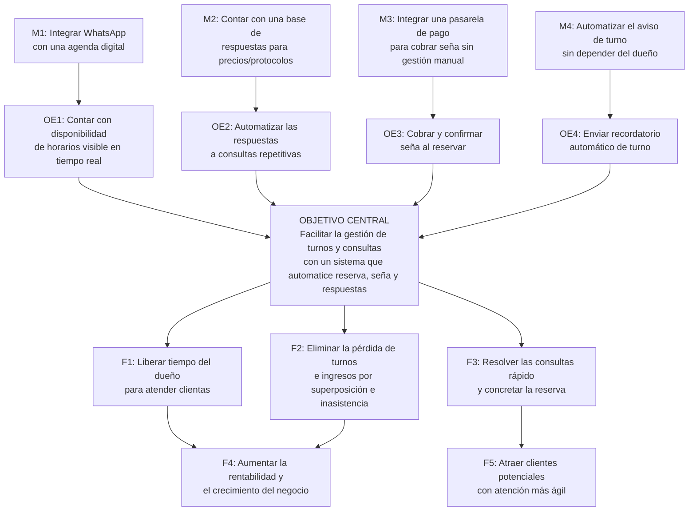

# Árbol de Objetivos

Espejo en positivo del Árbol de Problemas (`docs/01-arbol-de-problemas.md`),
construido con la tabla de conversión de `.claude/skills/arbol-de-objetivos/SKILL.md`:
efectos → fines, problema central → objetivo central, causas directas →
objetivos específicos, causas raíz → medios. También está armado en post-its
en el board de Miro "Proyecto informático 1", al lado del Árbol de
Problemas.

## Objetivo central

Facilitar la gestión de turnos y consultas de Bella Piel — Centro de
Estética Integral mediante un sistema que automatice la reserva, el cobro de
seña y las respuestas frecuentes, liberando el tiempo del dueño y reduciendo
los turnos perdidos (barrio de Flores, CABA, a 2026).

Es el mismo problema central del árbol anterior, reescrito en infinitivo y en
positivo: no es un objetivo distinto, es su conversión directa.

## Diagrama

## Tabla de conversión aplicada

| Árbol de Problemas | Árbol de Objetivos | Fechado (meta a 2026, Bella Piel) |
|---|---|---|
| C1: No hay disponibilidad de horarios visible en tiempo real | OE1: Contar con disponibilidad de horarios visible en tiempo real | De 5 a 0 superposiciones de turno por mes |
| C1.1: WhatsApp no integrado a agenda digital | M1: Integrar WhatsApp con una agenda digital | — (actividad, no lleva indicador propio) |
| C2: Consultas repetitivas respondidas una por una, a mano | OE2: Automatizar las respuestas a consultas repetitivas | De 95 a 38 minutos diarios de atención manual (-60%) |
| C2.1: No existe base de respuestas para precios/protocolos | M2: Contar con una base de respuestas para precios/protocolos | — |
| C3: No se cobra ni confirma seña al reservar | OE3: Cobrar y confirmar seña al reservar | De 6 a 3 turnos perdidos por semana (-50%) |
| C3.1: Cobrar seña exige gestión manual de transferencias | M3: Integrar una pasarela de pago para cobrar seña sin gestión manual | — |
| C4: No hay recordatorio automático de turno | OE4: Enviar recordatorio automático de turno | Contribuye a la misma meta de OE3 (turnos perdidos) |
| C4.1: El dueño no tiene tiempo de avisar turno a mano | M4: Automatizar el aviso de turno sin depender del dueño | — |
| E1: El dueño pierde horas respondiendo consultas | F1: Liberar tiempo del dueño para atender clientas | — (fin, no se mide en el bimestre) |
| E2: Se pierden turnos e ingresos | F2: Eliminar la pérdida de turnos e ingresos | — |
| E3: Las consultas tardan y se desiste de reservar | F3: Resolver las consultas rápido y concretar la reserva | — |
| E4: Menor rentabilidad y crecimiento limitado | F4: Aumentar la rentabilidad y el crecimiento del negocio | — |
| E5: Clientes eligen la competencia | F5: Atraer clientes potenciales con atención más ágil | — |

## Adónde va cada nodo en la MML

Según la tabla del skill: los objetivos específicos (OE1-OE4) son los
candidatos a Componentes, los medios (M1-M4) son las Actividades que
producen cada componente, y los fines directos (F1-F3) son el Fin de la
matriz. El objetivo central es el Propósito.

## Verificación de la lógica

Leído de corrido: si se integra WhatsApp con una agenda digital (M1), se
puede contar con disponibilidad de horarios en tiempo real (OE1); eso
contribuye a facilitar la gestión de turnos y consultas (objetivo central);
lo que libera tiempo del dueño y elimina la pérdida de turnos (F1, F2), y en
conjunto aumenta la rentabilidad del negocio (F4). Se sostiene leída en voz
alta.

## Qué falta

- Elegir, con el criterio de FODA (`docs/foda.md`, si se hace), qué medios son
  la alternativa de intervención de este bimestre y cuáles quedan fuera.
- Pasar OE1-OE4 y M1-M4 a la Matriz de Marco Lógico (`docs/03-matriz-marco-logico.md`).
