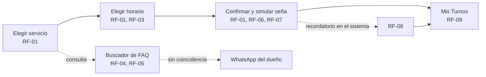

# Maquetado

Wireframes de media fidelidad de la Propuesta 1 (Bella Piel), armados en
Figma: https://www.figma.com/design/qEWMXwg68LQOtj9PzRnh1A/Untitled. Cada
pantalla está rotulada con los RF que cubre (`docs/04-requerimientos.md`)
directamente en el nombre del frame en Figma, y acá abajo con el enlace al
nodo puntual.

No hay capturas en `docs/assets/`: `figma.com` está bloqueado para descarga
directa en este entorno de trabajo. El enlace a cada pantalla en Figma
reemplaza la captura; cualquiera con acceso al archivo la ve ahí.

## User flow

La clienta entra por "Elegir servicio" (o por el buscador de preguntas
frecuentes si tiene una duda antes de reservar) y sale con un turno
confirmado y visible en "Mis Turnos". El buscador es un camino paralelo, no
un paso obligatorio del flujo principal: puede resolver la consulta o
derivar a un enlace de WhatsApp sin cortar la reserva.

## Pantalla → RF cubiertos

| Pantalla | RF / RNF cubiertos | Enlace |
|---|---|---|
| 1 — Elegir servicio | RF-01, RF-03 | [nodo 3:2](https://www.figma.com/design/qEWMXwg68LQOtj9PzRnh1A/Untitled?node-id=3-2) |
| 2 — Elegir horario | RF-01, RF-03 | [nodo 4:2](https://www.figma.com/design/qEWMXwg68LQOtj9PzRnh1A/Untitled?node-id=4-2) |
| 3 — Confirmar y simular seña | RF-01, RF-06, RF-07, RNF-04 | [nodo 8:2](https://www.figma.com/design/qEWMXwg68LQOtj9PzRnh1A/Untitled?node-id=8-2) |
| 4 — Buscador de preguntas frecuentes | RF-04, RF-05, RNF-09 | [nodo 8:30](https://www.figma.com/design/qEWMXwg68LQOtj9PzRnh1A/Untitled?node-id=8-30) |
| 5 — Mis Turnos | RF-09, RF-08 (recordatorio, visible como aviso en la tarjeta) | [nodo 10:2](https://www.figma.com/design/qEWMXwg68LQOtj9PzRnh1A/Untitled?node-id=10-2) |

RF-02 (agenda propia del dueño) no tiene pantalla en este maquetado: las 5
pantallas de arriba son el flujo de la clienta, y RF-02 es una herramienta
del lado del dueño (cargar/editar su disponibilidad), que queda como panel
de administración pendiente de diseñar — no es la misma UI que ve la
clienta.

RF-10 (vitrina) queda fuera del maquetado de este bimestre: es Could, y en
la semana 6 de 8 no hay margen para diseñar, revisar y ajustar una sexta
pantalla sin restarle tiempo al pitch y a la revisión cruzada de las 5
pantallas Must/Should que sí están. Se retoma en una siguiente iteración,
fuera de esta Carpeta de Proyecto V1.

## Justificación de las decisiones de diseño

- 3 pasos separados (servicio → horario → confirmación) en vez de un solo
  formulario largo: reduce la carga cognitiva y deja avanzar solo cuando el
  paso anterior está resuelto, atacando directamente C1/C2 del Árbol de
  Problemas (decisiones a medias por WhatsApp, sin estructura).
- La seña tiene su propia tarjeta, separada del resumen del turno, no es un
  campo más: la evidencia de `propuestas.md` dice que puede generar
  resistencia, así que se explica antes de confirmar el pago simulado (30%
  del valor del servicio, mínimo $5.000, reembolsable si se cancela con más
  de 24 h de anticipación — RF-07) en vez de aparecer como un cargo
  sorpresa. La pantalla no pide ningún dato de tarjeta — es un mock, no una
  pasarela real.
- El buscador de preguntas frecuentes muestra de dónde sale cada respuesta
  ("Base de precios y protocolos" o derivación a WhatsApp), así la clienta
  distingue una respuesta confiable de una que necesita al dueño, y el
  buscador no parece prometer algo que no puede cumplir.
- "Mis Turnos" no pide contraseña, solo el enlace mágico: es un
  requerimiento explícito (RF-09) para no agregar fricción a una clienta que
  reserva una vez cada tanto.

## Evaluación heurística (Nielsen)

| Heurística | Cómo se resuelve |
|---|---|
| 1. Visibilidad del estado del sistema | "Paso 1/2/3 de 3" en el header de reserva; badge "Confirmado" en Mis Turnos; el buscador marca la fuente de cada respuesta. |
| 2. Lenguaje del usuario | Sin jerga técnica: "Elegir horario", "Pagar seña", nunca "slot" ni "booking". |
| 3. Control y libertad | Flecha "←" para volver en cada paso de la reserva; botón "Cancelar turno" siempre visible en Mis Turnos. |
| 4. Consistencia y estándares | Un solo color primario (rosa) para toda acción principal, en las 5 pantallas; misma tipografía y radios de borde. |
| 5. Prevención de errores | Solo se muestran horarios realmente disponibles (RF-03) — no se puede ni intentar reservar un turno ya ocupado. |
| 6. Reconocer antes que recordar | El resumen de la Pantalla 3 repite servicio, fecha, hora y precio — la clienta no tiene que recordar lo que eligió antes. |
| 7. Flexibilidad y eficiencia | El buscador resuelve consultas frecuentes en un mensaje, sin pasar por los 3 pasos de reserva si solo se quiere saber un precio. |
| 8. Diseño estético y minimalista | Cada pantalla tiene una sola acción primaria (el botón inferior); nada compite con ella. |
| 9. Ayudar a reconocer y recuperarse de errores | Cuando el buscador no encuentra coincidencia, lo dice explícitamente y ofrece un camino concreto (botón "Hablar por WhatsApp"), no un error genérico. |
| 10. Ayuda y documentación | Se resuelve sin pantalla nueva: enlace "Ayuda" fijo en el header de las 5 pantallas, que lleva directo al WhatsApp del dueño (mismo camino que ya usa el asistente virtual cuando no sabe responder). Decisión tomada por tiempo — con 2 semanas de bimestre restantes no alcanza para una pantalla de FAQ propia — a validar en la revisión cruzada. |

## Preguntas para la coevaluación cruzada

1. La seña se pide recién en el paso 3, después de que la clienta ya eligió
   servicio y horario — ¿ese orden reduce el abandono, o conviene mostrar el
   monto de la seña desde el paso 1 para que no sea sorpresa al final?
2. El buscador deriva a WhatsApp cuando no encuentra coincidencia — ¿alcanza
   con un botón, o hace falta que le pase el historial de la conversación al
   dueño para que no tenga que preguntar todo de nuevo?
3. Con la restricción de C + SQL Server sin APIs, la seña y el recordatorio
   quedaron mockeados (no hay pago ni envío reales) — ¿esa simulación se
   entiende con solo texto en la pantalla, o hace falta una aclaración
   visual más explícita para que no parezca una promesa real?

## Qué falta

- Aplicar en Figma los cambios de esta semana: renombrar la pantalla del
  buscador (ya no "asistente virtual"), sacar cualquier referencia a
  Mercado Pago o Google Calendar, agregar el enlace "Ayuda" en el header,
  dejar RF-10 fuera de alcance — hoy están cerrados acá mismo, pero no en
  el archivo de Figma.
- Pasar el maquetado por la coevaluación cruzada con otro equipo antes de
  darlo por cerrado.
