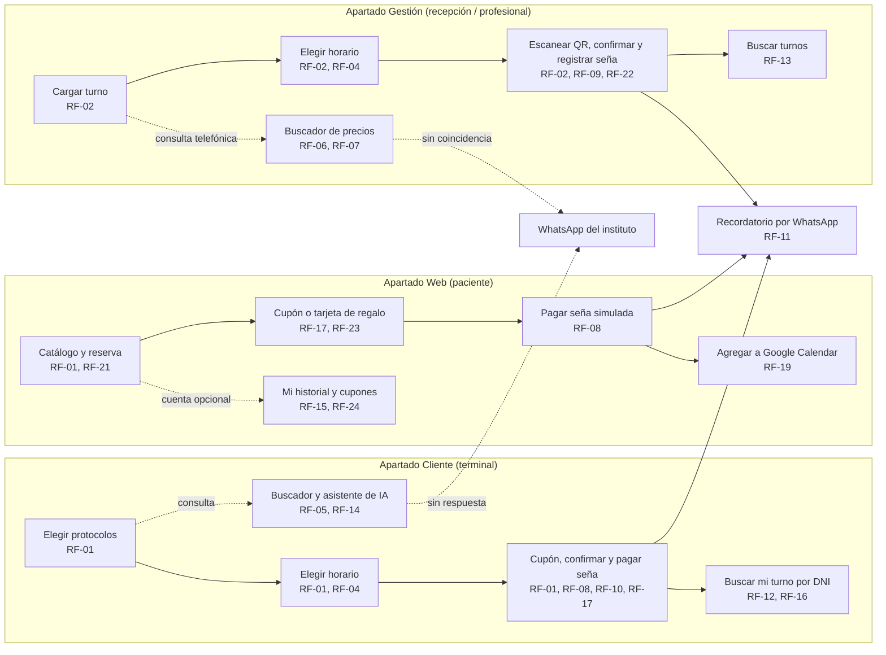

# Maquetado

El maquetado tuvo tres etapas. La primera (Semanas 5-6 reales) se hizo en
Figma como wireframes de una app móvil self-service remota. La segunda
(Semana 7 real) la reemplazó por dos apartados Qt: una terminal presencial y
la PC de recepción, porque en ese momento el stack no incluía web ni APIs.
La tercera es la vigente: el equipo **amplió el alcance** a base MySQL,
APIs externas permitidas (Google Calendar, WhatsApp, asistente de IA) y
**sitio web**, así que vuelve a existir un self-service remoto para la
paciente, ahora como tercer apartado.

## Los tres apartados

- **Apartado Cliente (terminal)**: pantalla táctil instalada en Dermalia,
  para que la paciente cargue su propio turno, consulte precios y busque
  su turno mientras está en el local.
- **Apartado Gestión**: lo usan la recepción y los profesionales desde la PC,
  para cargar turnos por teléfono, administrar disponibilidad, escanear
  cupones QR antes del pago y resolver consultas con el mismo buscador.
- **Apartado Web**: sitio para la paciente desde cualquier lugar: catálogo
  de protocolos, reserva, consulta y cancelación del turno, asistente de IA,
  cuenta opcional con cupones, tarjetas de regalo y descuentos.

Los tres comparten los Componentes R1-R4 de la MML y la misma base MySQL
(`docs/03-matriz-marco-logico.md`); el detalle de RF por apartado está en
`docs/04-requerimientos.md`.

## Mockup de escritorio (Qt)

Mockup interactivo con las pantallas de los apartados de escritorio,
navegables desde un selector superior (Cliente / Gestión) y un panel lateral con las
pantallas de cada uno:
https://claude.ai/artifact/LAL3dVf5JWdd3SD7VYuRFX

Pensado como referencia visual para construir la interfaz real en Qt
Designer / Qt Widgets (el apartado Cliente en una ventana táctil vertical,
el apartado Gestión en una ventana de escritorio horizontal), no como el
diseño final pixel a pixel. El apartado Web todavía no tiene maquetado
propio: está pendiente.

## User flow

La paciente entra por la terminal cuando está en el instituto, por la web
desde su casa, y la recepción por su PC cuando la paciente llama. Todos los
caminos terminan en el mismo dato: un turno con seña registrada, recordatorio
y, si corresponde, un cupón o una tarjeta aplicados.

## Pantalla → RF cubiertos

**Apartado Cliente**

| Pantalla | RF cubiertos |
|---|---|
| 1, Elegir protocolos (uno o varios) | RF-01, RF-04 |
| 2, Elegir horario | RF-01, RF-04 |
| 3, Cupón, confirmar turno y pagar seña | RF-01, RF-08, RF-10, RF-17, RF-23 |
| 4, Buscador de precios y asistente de IA | RF-05, RF-07, RF-14 |
| 5, Buscar mi turno (DNI/teléfono) | RF-12, RF-16, RF-11 (recordatorio) |

**Apartado Gestión**

| Pantalla | RF cubiertos |
|---|---|
| 1, Cargar turno | RF-02, RF-04 |
| 2, Elegir horario | RF-02, RF-04 |
| 3, Confirmar turno y registrar seña | RF-02, RF-09, RF-10, RF-17 |
| 4, Buscador de precios y protocolos | RF-06, RF-07 |
| 5, Buscar turnos (nombre/DNI/teléfono) | RF-13, RF-11 (recordatorio) |
| 6, Escanear QR de cupón o tarjeta (pendiente) | RF-22, RF-23 |

**Apartado Web** (pendiente de maquetar)

| Pantalla | RF cubiertos |
|---|---|
| Catálogo y reserva | RF-01, RF-04, RF-21 |
| Cupón, tarjeta de regalo y pago de seña | RF-08, RF-10, RF-17, RF-23 |
| Agregar a Google Calendar | RF-19 |
| Cuenta, historial y cupones | RF-15, RF-16, RF-24 |
| Asistente de IA | RF-14, RF-07 |

Pantallas sin wireframe todavía: administración de disponibilidad y
protocolos por profesional (RF-03, RF-18), escaneo de QR (RF-22) y todo el
apartado Web.

## Justificación de las decisiones de diseño

- Mismo flujo de 3 pasos en los dos apartados (protocolo → horario →
  confirmación): la paciente y la recepción entienden la misma secuencia,
  y el equipo solo mantiene una lógica de negocio, no dos.
- La terminal (Cliente) usa controles más grandes y espaciados, pensados
  para pantalla táctil; la PC de recepción (Gestión) usa una densidad
  mayor, pensada para mouse y teclado y para repetir la carga muchas
  veces por día.
- La seña tiene su propia tarjeta en los dos apartados, separada del
  resumen del turno: la evidencia de `propuestas.md` dice que puede
  generar resistencia en la paciente, así que el monto y la regla (30%
  del precio final, mínimo $20.000, reembolsable con +24h, RF-10)
  quedan visibles antes de confirmar el pago simulado, en vez de aparecer
  como un cargo sorpresa.
- El buscador de precios y protocolos muestra de dónde sale cada
  resultado ("Base de precios y protocolos" o derivación a WhatsApp), en
  los dos apartados, para no prometer una respuesta que el sistema no
  puede resolver.
- "Buscar mi turno" (Cliente) y "Buscar turnos" (Gestión) no dependen de
  ningún enlace ni contraseña: alcanza con DNI o teléfono, porque en los
  dos casos hay alguien físicamente presente verificando la identidad. En
  la web, el historial por DNI sin cuenta muestra solo lo mínimo, y quien
  quiere ver todo ingresa con su cuenta opcional.
- El campo "¿Tenés un cupón de descuento?" está en el paso de confirmación,
  antes del pago, y muestra el precio ya con el descuento aplicado; si la
  paciente se olvida, el QR permite aplicarlo en el mostrador antes de pagar.

## Evaluación heurística (Nielsen)

| Heurística | Cómo se resuelve |
|---|---|
| 1. Visibilidad del estado del sistema | "Paso 1/2/3 de 3" en la carga de turno de los dos apartados; badge "Confirmado" al buscar un turno; el buscador de precios marca la fuente de cada resultado. |
| 2. Lenguaje del usuario | Sin jerga técnica: "Elegir horario", "Pagar seña" (Cliente) / "Registrar seña" (Gestión), nunca "slot" ni "booking". |
| 3. Control y libertad | Botón "Volver" en cada paso de la carga; "Cancelar turno" siempre visible en las búsquedas. |
| 4. Consistencia y estándares | Mismo color primario y tipografía en los dos apartados; la terminal usa controles más grandes, pero la misma paleta y jerarquía visual. |
| 5. Prevención de errores | Solo se muestran horarios realmente disponibles (RF-04), no se puede cargar un turno sobre uno ya ocupado, en ningún apartado. |
| 6. Reconocer antes que recordar | El resumen antes de confirmar repite protocolo, fecha, hora y precio en los dos apartados. |
| 7. Flexibilidad y eficiencia | El buscador resuelve una consulta de precio en un resultado, sin pasar por los 3 pasos de carga de turno. |
| 8. Diseño estético y minimalista | Cada pantalla tiene una sola acción primaria; nada compite con ella. |
| 9. Ayudar a reconocer y recuperarse de errores | Cuando el buscador no encuentra coincidencia, lo dice explícitamente y ofrece derivar a WhatsApp, no un error genérico. |
| 10. Ayuda y documentación | Enlace "Ayuda" fijo en la barra superior de los dos apartados. |

## Preguntas para la coevaluación cruzada

1. ¿El mismo flujo de 3 pasos funciona igual de bien para una paciente
   tocando una pantalla en la terminal que para la recepción usando mouse y
   teclado todo el día, o alguno de los dos necesita un diseño distinto?
2. El buscador deriva a WhatsApp cuando no encuentra coincidencia en los
   dos apartados, ¿alcanza con marcarlo en pantalla, o la terminal (sin
   nadie de recepción cerca en ese momento) necesita un paso adicional?
3. La seña se simula imitando un pago real (estilo pasarela), ¿esa
   simulación se entiende con solo texto en pantalla, o hace falta una
   aclaración visual más explícita, sobre todo en la terminal donde nadie de
   recepción está ahí para aclararlo en el momento?
4. Con cupones, tarjetas de regalo y QR, ¿el paso de confirmación sigue
   siendo de 3 pasos, o se vuelve demasiado cargado?

## Qué falta

- Maquetar el apartado Web y las pantallas nuevas (cuenta, cupones,
  tarjetas de regalo, asistente de IA, escaneo de QR).
- Diseñar la pantalla de administración de disponibilidad (RF-03) y de
  protocolos por profesional (RF-18), que todavía no tienen wireframe.
- Coevaluación cruzada con otro equipo (estado general: ver README.md).

## Historial: maquetado móvil remoto en Figma (reemplazado)

Las 5 pantallas originales, pensadas como app móvil self-service remota
para la paciente (reserva desde el celular, con enlace mágico), quedan en
Figma como registro del primer intento:
https://www.figma.com/design/qEWMXwg68LQOtj9PzRnh1A/Untitled. Ya no
reflejan el modelo de uso actual (terminal, recepción y web), así que no son la referencia vigente. Se dejan sin borrar porque
muestran el proceso de descarte, igual que las propuestas rechazadas en
`docs/propuestas.md`.
