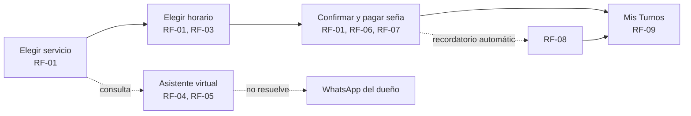

# Maquetado

Wireframes de media fidelidad de la Propuesta 1 (Bella Piel), armados en
Figma: **https://www.figma.com/design/qEWMXwg68LQOtj9PzRnh1A/Untitled**.
Cada pantalla está rotulada con los RF que cubre (`docs/04-requerimientos.md`)
directamente en el nombre del frame en Figma, y acá abajo con el enlace al
nodo puntual.

> Nota: no hay capturas en `docs/assets/` — `figma.com` está bloqueado para
> descarga directa en este entorno de trabajo. El enlace a cada pantalla en
> Figma reemplaza la captura; cualquiera con acceso al archivo la ve ahí.

## User flow

La clienta entra por "Elegir servicio" (o por el asistente virtual si tiene
una duda antes de reservar) y sale con un turno confirmado y visible en "Mis
Turnos". El asistente es un camino paralelo, no un paso obligatorio del flujo
principal — puede resolver la consulta o derivar a WhatsApp sin cortar la
reserva.

## Pantalla → RF cubiertos

| Pantalla | RF / RNF cubiertos | Enlace |
|---|---|---|
| 1 — Elegir servicio | RF-01, RF-03 | [nodo 3:2](https://www.figma.com/design/qEWMXwg68LQOtj9PzRnh1A/Untitled?node-id=3-2) |
| 2 — Elegir horario | RF-01, RF-03 | [nodo 4:2](https://www.figma.com/design/qEWMXwg68LQOtj9PzRnh1A/Untitled?node-id=4-2) |
| 3 — Confirmar y pagar seña | RF-01, RF-06, RF-07, RNF-04 | [nodo 8:2](https://www.figma.com/design/qEWMXwg68LQOtj9PzRnh1A/Untitled?node-id=8-2) |
| 4 — Asistente virtual | RF-04, RF-05 | [nodo 8:30](https://www.figma.com/design/qEWMXwg68LQOtj9PzRnh1A/Untitled?node-id=8-30) |
| 5 — Mis Turnos | RF-09, RF-08 (recordatorio, visible como aviso en la tarjeta) | [nodo 10:2](https://www.figma.com/design/qEWMXwg68LQOtj9PzRnh1A/Untitled?node-id=10-2) |

**RF-02** (sincronización con Google Calendar) y **RF-10** (vitrina) no tienen
pantalla propia todavía: RF-02 es una integración de backend sin UI dedicada;
RF-10 es *Could* y queda para una siguiente iteración del maquetado si da el
tiempo del bimestre.

## Justificación de las decisiones de diseño

- **3 pasos separados (servicio → horario → confirmación) en vez de un solo
  formulario largo:** reduce la carga cognitiva y deja avanzar solo cuando el
  paso anterior está resuelto — ataca directamente C1/C2 del Árbol de
  Problemas (decisiones a medias por WhatsApp, sin estructura).
- **La seña es su propia tarjeta separada del resumen del turno**, no un
  campo más: la evidencia de `propuestas.md` dice que puede generar
  resistencia, así que se explica antes de pedir el pago (monto + qué pasa
  con ese dinero), en vez de aparecer como un cargo sorpresa.
- **El asistente virtual muestra de dónde sale cada respuesta** ("Base de
  precios y protocolos" / derivación a WhatsApp): así la clienta distingue
  una respuesta automática confiable de una que necesita al dueño — evita que
  el asistente parezca prometer algo que no puede cumplir.
- **"Mis Turnos" no pide contraseña**, solo el enlace mágico: es un
  requerimiento explícito (RF-09) para no agregar fricción a una clienta que
  reserva una vez cada tanto.

## Evaluación heurística (Nielsen)

| Heurística | Cómo se resuelve |
|---|---|
| 1. Visibilidad del estado del sistema | "Paso 1/2/3 de 3" en el header de reserva; badge "Confirmado" en Mis Turnos; el asistente marca la fuente de cada respuesta. |
| 2. Lenguaje del usuario | Sin jerga técnica: "Elegir horario", "Pagar seña", nunca "slot" ni "booking". |
| 3. Control y libertad | Flecha "←" para volver en cada paso de la reserva; botón "Cancelar turno" siempre visible en Mis Turnos. |
| 4. Consistencia y estándares | Un solo color primario (rosa) para toda acción principal, en las 5 pantallas; misma tipografía y radios de borde. |
| 5. Prevención de errores | Solo se muestran horarios realmente disponibles (RF-03) — no se puede ni intentar reservar un turno ya ocupado. |
| 6. Reconocer antes que recordar | El resumen de la Pantalla 3 repite servicio, fecha, hora y precio — la clienta no tiene que recordar lo que eligió antes. |
| 7. Flexibilidad y eficiencia | El asistente resuelve consultas frecuentes en un mensaje, sin pasar por los 3 pasos de reserva si solo se quiere saber un precio. |
| 8. Diseño estético y minimalista | Cada pantalla tiene una sola acción primaria (el botón inferior); nada compite con ella. |
| 9. Ayudar a reconocer y recuperarse de errores | Cuando el asistente no sabe la respuesta, lo dice explícitamente y ofrece un camino concreto (botón "Hablar por WhatsApp"), no un error genérico. |
| 10. Ayuda y documentación | Pendiente — no hay pantalla de FAQ/ayuda todavía. Queda anotado como punto débil para la coevaluación. |

## Preguntas para la coevaluación cruzada

1. La seña se pide recién en el paso 3, después de que la clienta ya eligió
   servicio y horario — ¿ese orden reduce el abandono, o conviene mostrar el
   monto de la seña desde el paso 1 para que no sea sorpresa al final?
2. El asistente virtual deriva a WhatsApp cuando no sabe responder — ¿alcanza
   con un botón, o hace falta que le pase el historial de la conversación al
   dueño para que no tenga que preguntar todo de nuevo?

## Qué falta

- Pantalla de ayuda/FAQ (heurística 10, sin resolver).
- Diseñar RF-02 (confirmación de sincronización con Calendar, aunque sea sin
  pantalla propia) y evaluar si RF-10 entra en el bimestre.
- Pasar el maquetado por la coevaluación cruzada con otro equipo antes de
  darlo por cerrado.
