# Manual de usuario

Cómo usar Dermalia en el día a día. Lo usan la **paciente** (en la terminal táctil del
instituto) y la **recepción** (en la PC, con el programa de Gestión); la **administración**
consulta reportes y auditoría desde Gestión. Para instalar o mantener el sistema, ver el
[manual técnico](13-manual-tecnico.md).

> **Con base y sin base.** Con la base de datos conectada, todo lo que se ve sale de la base, y
> Gestión y la terminal se actualizan solas cada 3 segundos: un turno que se saca o se cancela en
> un programa aparece en el otro sin tocar nada.
> Si la base no responde, aparece una franja amarilla y los dos programas siguen andando con
> un archivo local de esta PC (lo comparten Gestión y la terminal). Los turnos que se cargan
> así se mandan solos a la base cuando vuelve la conexión.
>
> Las capturas de este manual se sacaron con la base cargada con los datos de ejemplo.

## 1. Para la paciente (terminal táctil)

### Inicio

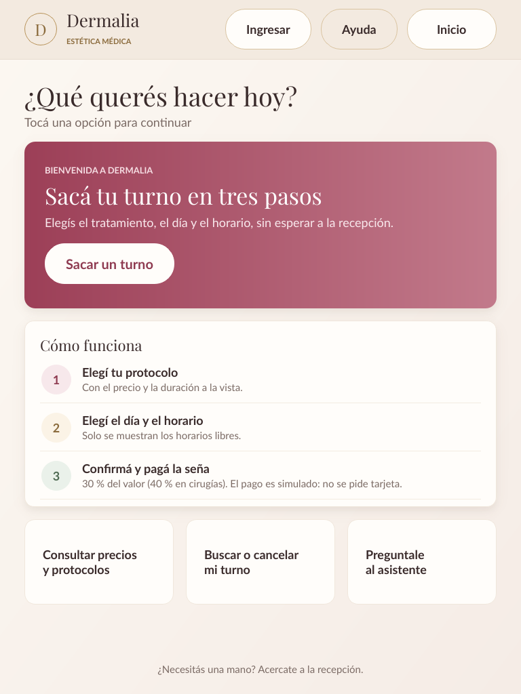

Tres opciones: **Sacar un turno**, **Consultar precios** y **Buscar o cancelar mi turno**.
Desde cualquier pantalla, el botón **Inicio** de arriba vuelve acá.

### Tu cuenta (opcional)

Arriba a la derecha está **Ingresar**. Sin cuenta se puede sacar turno igual, con el DNI; con
cuenta, la terminal ya sabe tus datos (no los escribís) y *Buscar mi turno* te muestra tus turnos solo.

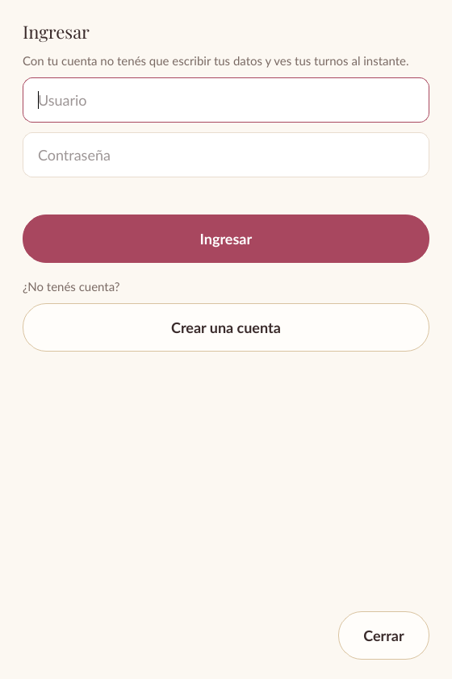

- **Ingresar:** usuario y contraseña. Arriba aparece "Hola, (tu nombre)".
- **¿No tenés cuenta?** Tocá *Crear una cuenta*: nombre y apellido, DNI, teléfono, fecha de nacimiento,
  email, usuario y contraseña (dos veces). La cuenta queda guardada en la base y quedás ingresada.
  Si ya te atendiste en el instituto, usá el mismo DNI y teléfono que diste: si el teléfono no
  coincide, la terminal te pide que lo actualices en la recepción.
- **Salir:** tocá "Hola, (tu nombre)" y confirmá. Como la terminal es compartida, si nadie la toca
  por 3 minutos la sesión se cierra sola.
- Las cuentas del personal (recepción, administración) no sirven acá: se usan en Gestión.

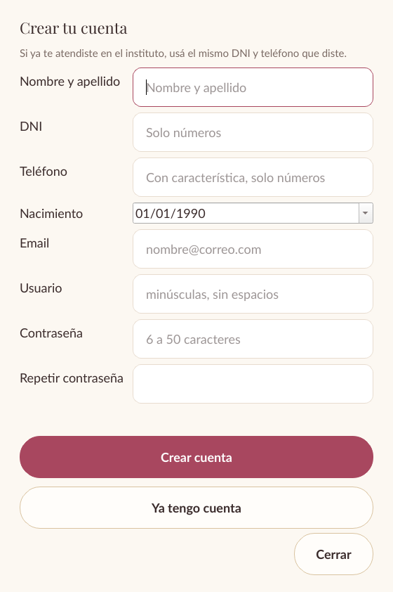

### Cuenta en el sitio web

En el sitio también es opcional: sin ella todo funciona con el DNI o el teléfono. Si la creás
(*Ingresar* → *Crear mi cuenta*, con usuario, email y contraseña), el sitio te muestra tus turnos
sin pedirte el DNI y la reserva te trae tus datos ya cargados. Si ya sacaste un turno antes, usá
el mismo DNI y el mismo teléfono: así tu cuenta se une a tu historial. Tras 5 contraseñas
equivocadas la cuenta se bloquea 15 minutos. La misma cuenta sirve en la terminal y en el sitio.

### Sacar un turno (3 pasos)

**1. Elegí tu protocolo.** Tocá el tratamiento: se ve la duración y el precio. Podés sumar hasta
**3 protocolos** en el mismo turno (los tocás de a uno). Si tocás una **cirugía**, la terminal te
avisa que primero hay que reservar la **consulta prequirúrgica** y te ofrece sumarla. *Ver resumen*
muestra qué es, cuántas sesiones lleva, la zona, en qué capa de la piel actúa, qué hacer antes y
después y para quién no es: el mismo resumen que la ficha del sitio web. *Continuar*.

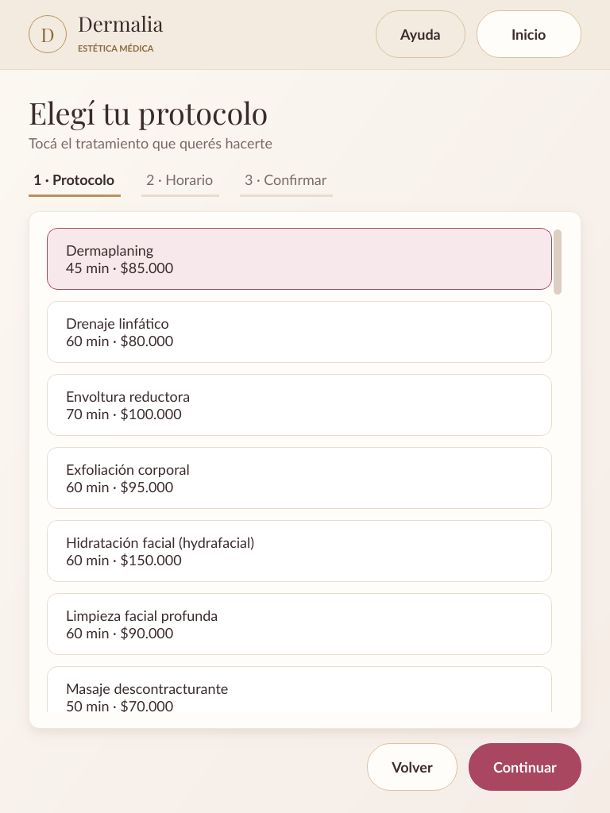

**2. Elegí tu horario.** Tocá un día en el calendario y después una hora libre. Solo aparecen
los horarios libres de los profesionales que hacen ese protocolo.

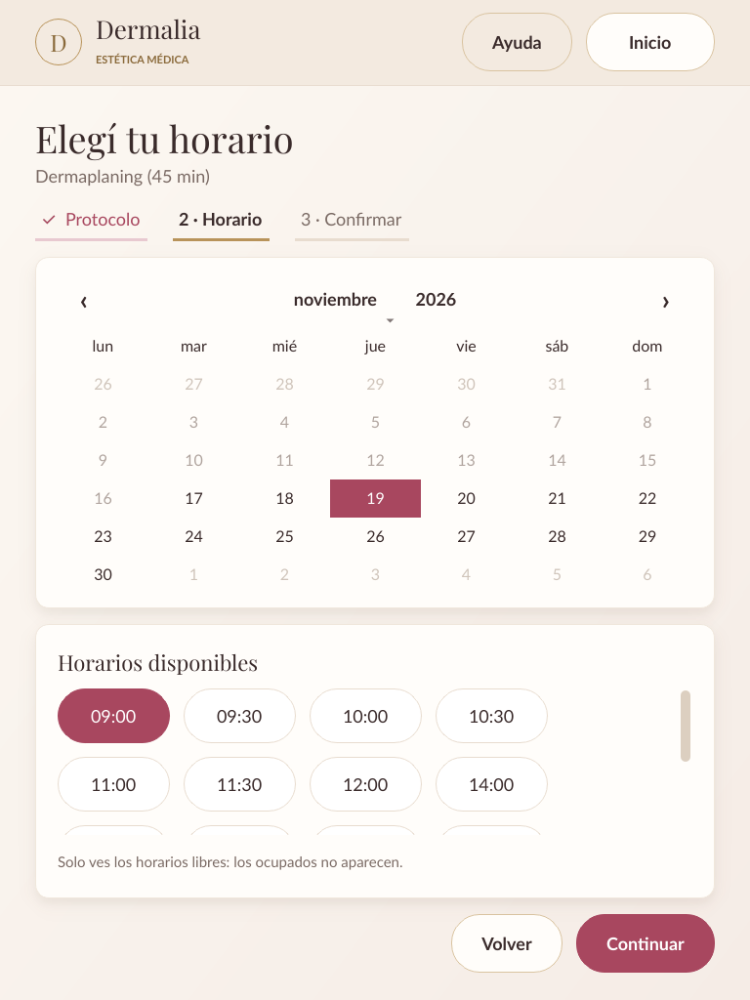

- Los meses que ya pasaron no se pueden elegir, y los años empiezan en 2026.
- Si tocás un día de este mes que ya pasó, el programa te pregunta si querés ese mismo día y
  horario **del año que viene**.
- Los domingos el instituto no atiende.

**3. Confirmá tu turno.** Escribí tu nombre y apellido, tu DNI y tu teléfono. A la derecha se
ve la **seña** (30% del precio; 40% en cirugías). *Pagar seña (simulado)* la marca como paga: no
se pide tarjeta ni se cobra dinero. Si tenés un **cupón** (un descuento personal, que se revisa con
tu DNI) o una **tarjeta de regalo** (la seña sale de su saldo), escribí el código y tocá *Aplicar*.
Tocá *Confirmar turno*.

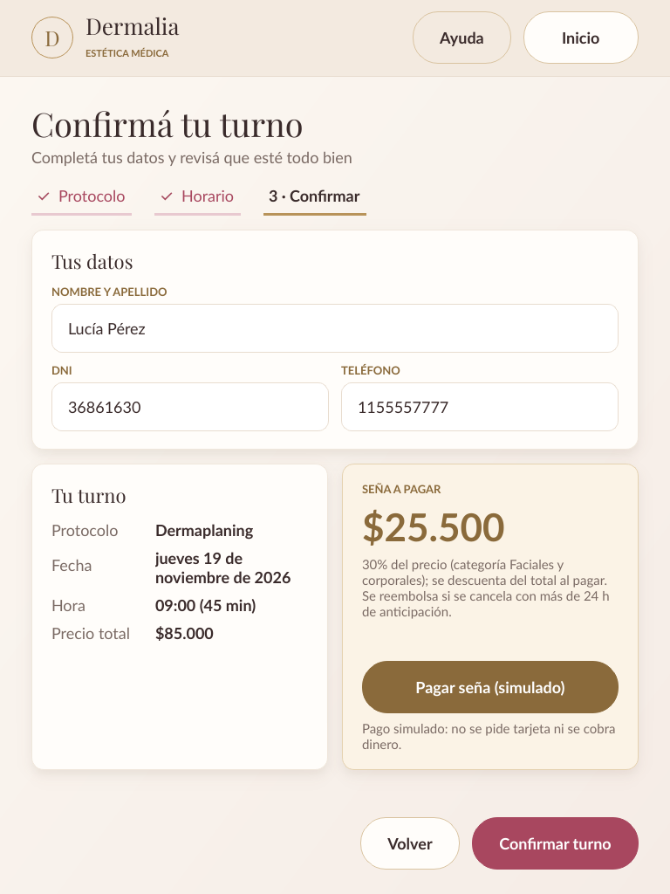

- El sitio web hace lo mismo y con las mismas reglas: mismos protocolos, validaciones, cupones, tarjetas
  de regalo y reglas de seña y cancelación.
- Si es tu primera vez, el programa te pregunta la **fecha de nacimiento** para darte de alta.
- Mientras escribís, el nombre no acepta números y el DNI y el teléfono no aceptan letras.
- Si otra persona tomó ese horario un segundo antes, te avisa y te deja elegir otro.

Al confirmar ves el código de la seña (`SIM-…`) y el programa te lleva a tu turno.

### Consultar precios

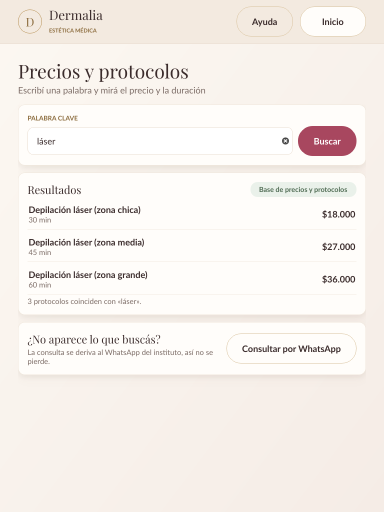

Escribí una palabra (no importan las mayúsculas ni las tildes: "laser" encuentra "láser") y aparecen
los tratamientos que coinciden, con el precio, la duración y *Ver resumen*. Sin escribir nada se ven
todos. Si no aparece lo que buscás, *Consultar por WhatsApp* abre WhatsApp con tu consulta.

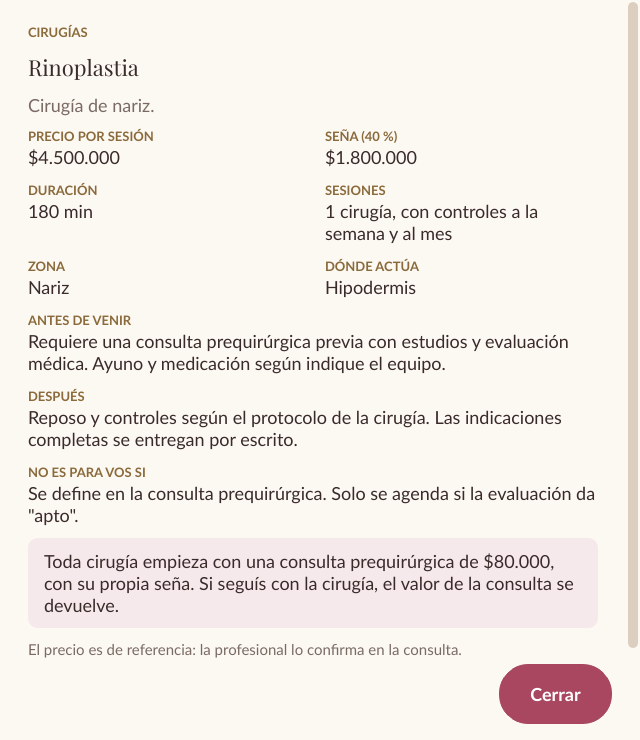

### Buscar o cancelar mi turno

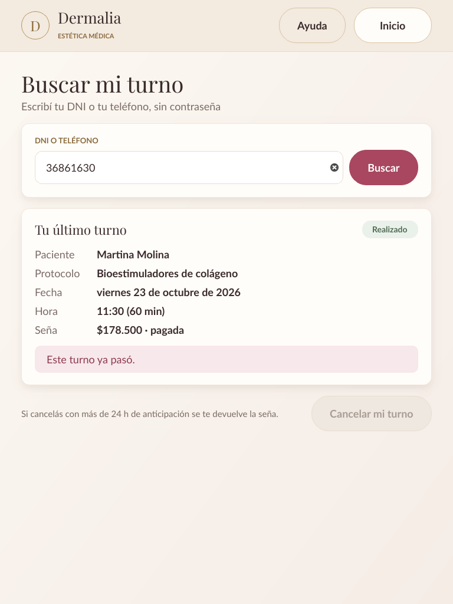

Escribí tu **DNI** o tu **teléfono** (sin contraseña) y tocá *Buscar*. Se muestra tu próximo
turno con el recordatorio que vas a recibir; si no tenés turnos por venir, el último que tuviste.

Para cancelar tocá *Cancelar mi turno*. Si tenés más de un turno, primero elegís **cuál**
cancelar de una lista; después confirmás.

| Cancelás... | Qué pasa con la seña |
|---|---|
| Con **más de 24 horas** de anticipación | Se te devuelve el **100%** |
| Con **24 horas o menos**, o si no venís | La seña **queda retenida** |

## 2. Cirugías (rinoplastia, lipoescultura, mamoplastia, blefaroplastia, abdominoplastia, otoplastia, ginecomastia)

1. Primero se hace una **consulta previa** con su seña.
2. El profesional carga el resultado (en Gestión, pantalla *Consultas previas*):
   - **Apta:** la paciente puede agendar la cirugía durante **6 meses**. Al agendarla, la seña de
     la consulta se le devuelve. La seña de la cirugía es del **40%**.
   - **No apta:** se le devuelve la seña de la consulta menos el **10%**.
3. Si pasan los 6 meses sin agendar, la evaluación **vence** y el instituto se queda con la seña
   de la consulta. Si la paciente **reclama** (una sola vez), se le devuelve el 50%.

## 3. Para la recepción (programa de Gestión)

Al abrir el programa pide el **usuario y la contraseña** del personal: cada acción queda en el
registro de auditoría a nombre de quien ingresó. El menú de la izquierda lleva a cada pantalla.

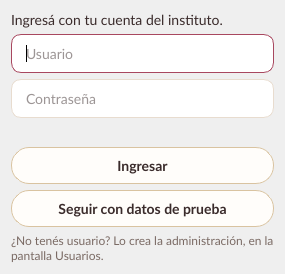

- Con los datos de ejemplo cargados, se puede entrar como `recepcion1` (recepción) o `admin`
  (administración), las dos con la contraseña `dermalia2026`. En el instituto real hay que cambiarlas
  (pantalla *Usuarios*, *Cambiar mi contraseña*).
- No hay registro libre: los usuarios los crea la **administración** (ver *Usuarios*, más abajo).
- Si se toca *Seguir con datos de prueba*, aparece una franja amarilla avisando que **nada de lo
  que se cargue va a la base**; con *Ingresar* se vuelve a pedir el usuario.

### Inicio

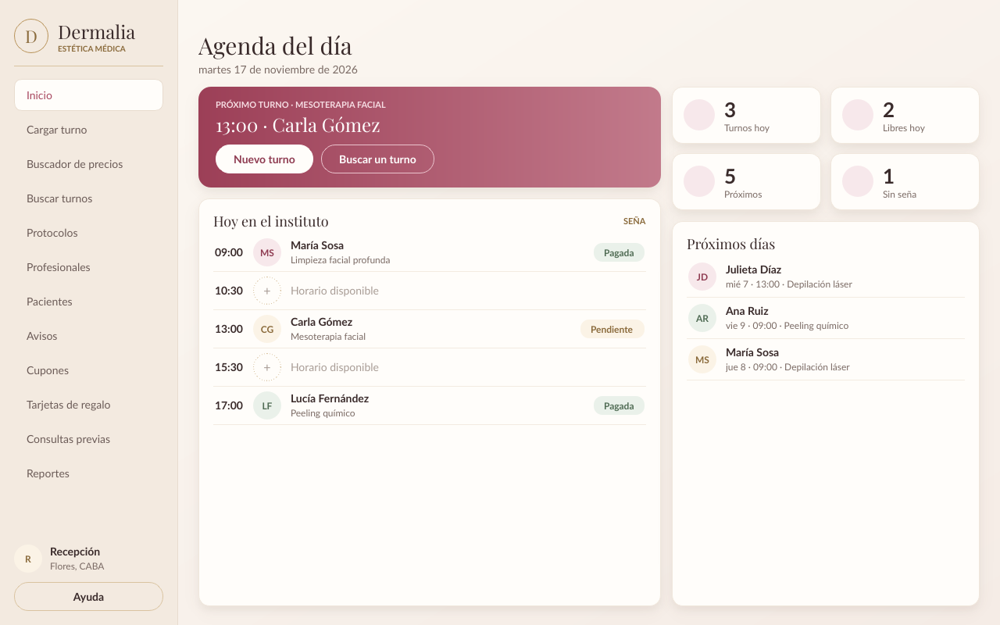

La agenda del día con el estado de cada turno y accesos rápidos a *Cargar turno* y *Buscar turnos*.

### Cargar turno (cuando la paciente llama o se acerca)

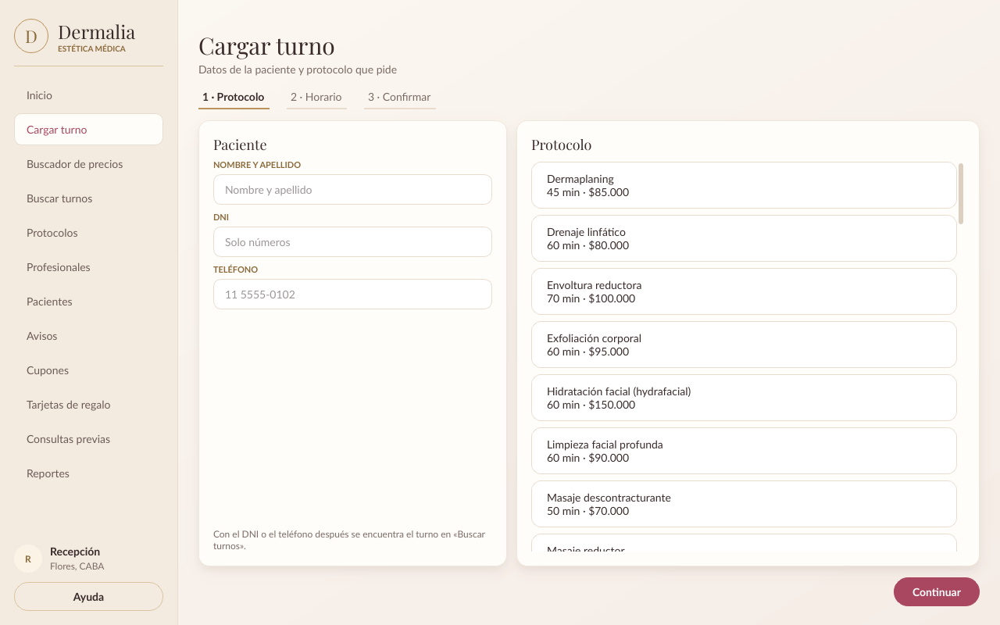

1. Datos de la paciente (nombre y apellido, DNI, teléfono) y el protocolo.
2. Día y horario libre (con el profesional que atiende).
3. Resumen, seña y *Confirmar turno*. Si es una paciente nueva, el programa pide la fecha de nacimiento.

### Buscar turnos

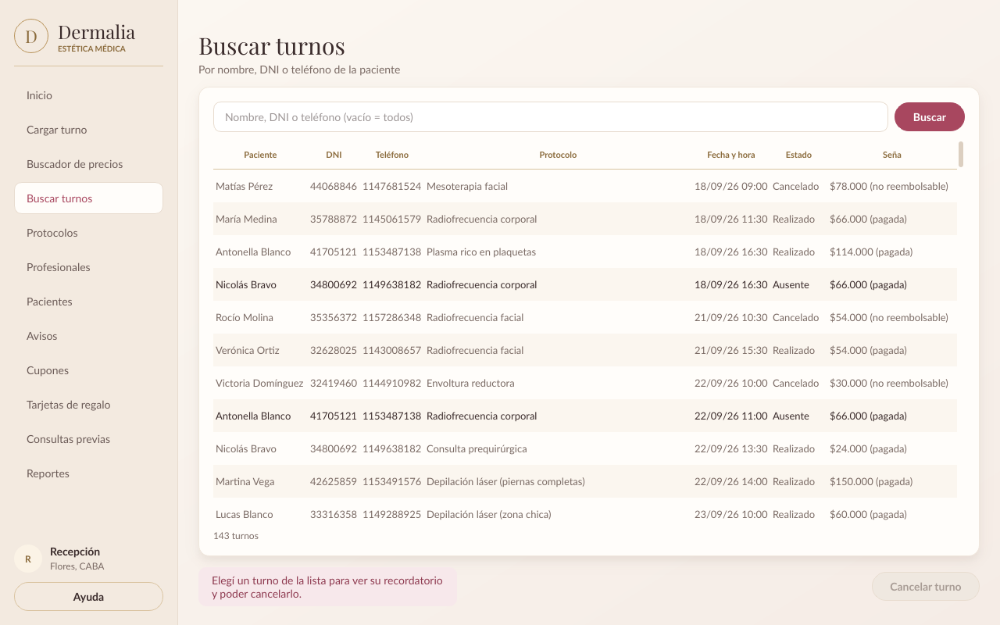

Por nombre, DNI o teléfono. Al elegir un turno se ve su recordatorio y se puede **cancelar** (misma
regla de las 24 horas).

### Protocolos, Profesionales y Pacientes

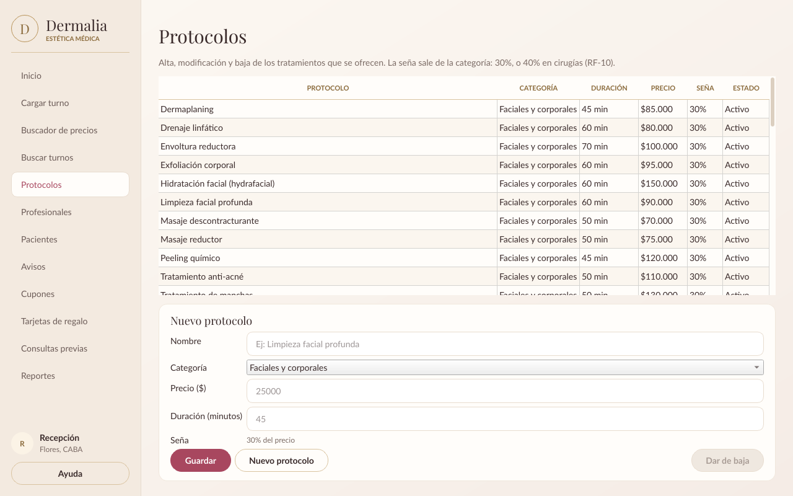

- **Protocolos:** alta, cambio de precio y duración, y baja. Los turnos ya reservados conservan el
  precio con el que se sacaron. *Ver resumen* muestra la ficha del tratamiento elegido (la misma de la
  web y de la terminal). El *Buscador de precios* de Gestión es el mismo de la terminal.

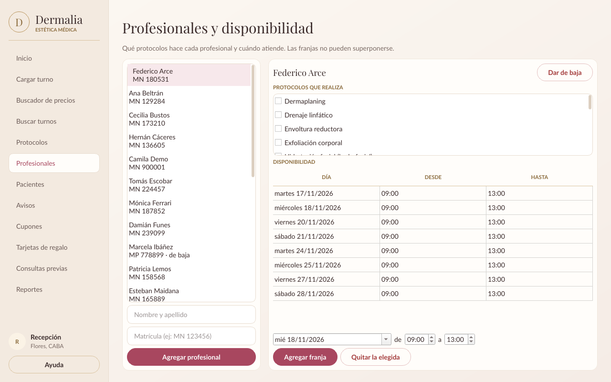

- **Profesionales:** qué protocolos hace cada uno y sus franjas de atención. Dos franjas no se
  pueden superponer.

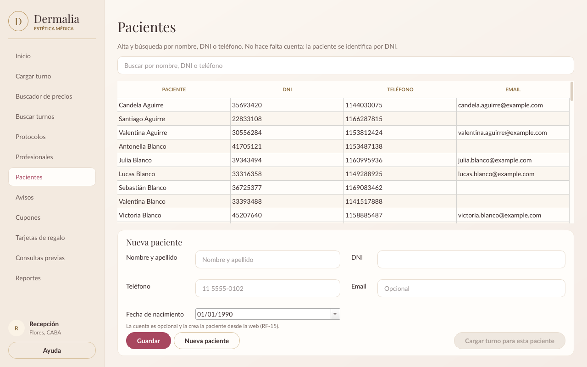

- **Pacientes:** alta, búsqueda y modificación. Desde una paciente se puede ir directo a cargarle un turno.

### Avisos

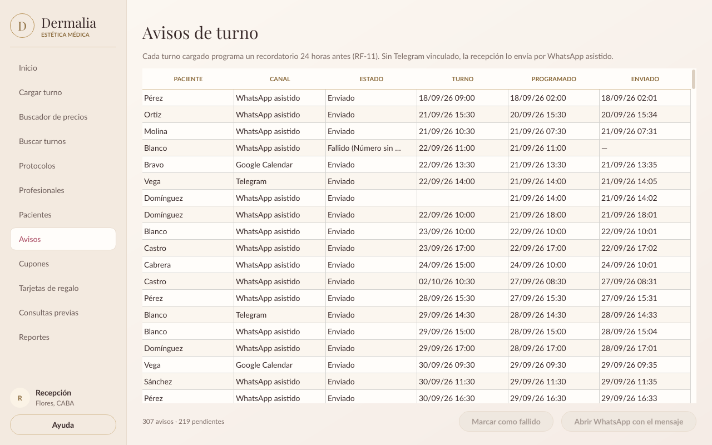

Cada turno programa un recordatorio 24 horas antes. Sin Telegram, la recepción lo manda por
WhatsApp con *Abrir WhatsApp con el mensaje*.

### Cupones

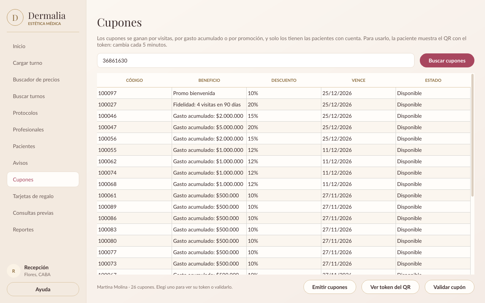

1. Escribí el DNI de la paciente y tocá *Buscar cupones*.
2. Elegí un cupón:
   - *Ver token del QR* muestra el token que tiene la paciente en el teléfono (cambia cada 5 minutos).
   - *Validar cupón*: escribís el token que te muestra la paciente y el programa dice si vale y
     cuánto descuenta.
3. *Emitir cupones* revisa las reglas (visitas, gasto acumulado, promociones) y emite los que
   correspondan. Normalmente lo hace el sistema solo.

### Tarjetas de regalo

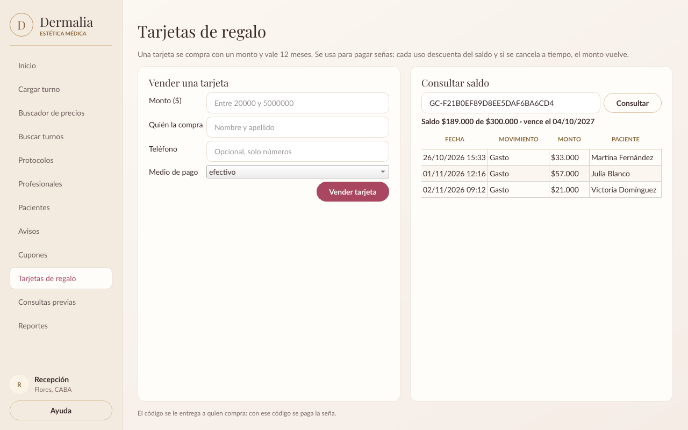

- **Vender:** monto (de $20.000 a $5.000.000), quién la compra, teléfono (opcional) y medio de
  pago. El programa da el **código** de la tarjeta: se le entrega a quien compra. Vale 12 meses.
- **Consultar saldo:** escribí el código y se ve el saldo, el vencimiento y cada gasto o devolución.

### Consultas previas de cirugía

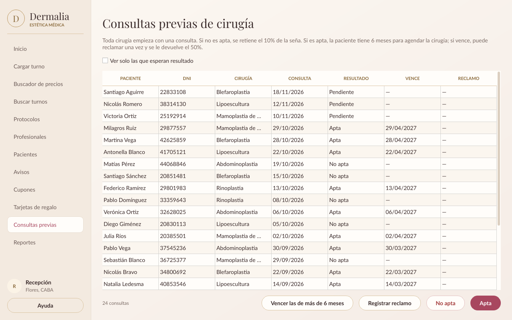

- Elegí una consulta y tocá **Apta** o **No apta** (se pueden agregar observaciones).
- *Registrar reclamo*: para una evaluación vencida que la paciente reclama.
- *Vencer las de más de 6 meses*: la tarea del día (normalmente la corre el sistema solo).
- *Ver solo las que esperan resultado* deja solo las pendientes.

### Usuarios

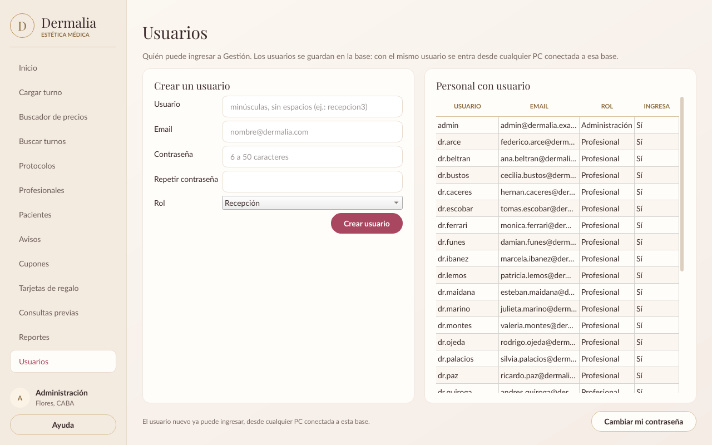

- La **administración** crea los usuarios del personal: usuario, email, contraseña y si es de
  recepción o de administración. El usuario queda guardado en la base, así que sirve para ingresar
  desde **cualquier PC conectada a esa misma base**.
- La recepción ve la lista pero no puede crear usuarios.
- *Cambiar mi contraseña* (cualquiera que ingresó): pide la actual y dos veces la nueva.
- Los profesionales se dan de alta en *Profesionales*, con su matrícula.

### Sin conexión

Si aparece la franja amarilla **"sin conexión con la base de datos"**, el programa sigue andando:
guarda los turnos en la PC y avisa cuántos esperan. *Reintentar* vuelve a conectar y, al
conectar, los turnos guardados **se envían solos**. Cupones, tarjetas, consultas previas y
reportes necesitan la base: sin conexión quedan deshabilitados.

## 4. Para la administración

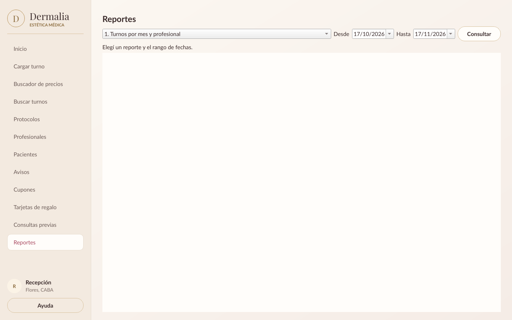

En la pantalla **Reportes** se elige el reporte, el rango de fechas y *Consultar*:

| Pregunta | Reporte (stored procedure) |
|---|---|
| ¿Cuántos turnos tuvo cada profesional por mes y cuánto facturó? | `agenda.sp_reporte_turnos_por_periodo_profesional` |
| ¿Cuánto se cobró, devolvió y retuvo de señas? | `pagos.sp_reporte_ingresos_sena` |
| ¿Cuántos turnos se pierden por cancelación o inasistencia? | `agenda.sp_reporte_cancelaciones_inasistencias` |
| ¿Cómo salieron las evaluaciones de cirugía? | `clinica.sp_reporte_evaluaciones_cirugias` |
| ¿Qué protocolos se piden más? | `clinica.sp_reporte_protocolos_mas_pedidos` |
| ¿Qué tan ocupado está cada profesional? | `agenda.sp_reporte_ocupacion_profesional` |
| ¿Se usan los cupones? | `beneficios.sp_reporte_cupones` |
| ¿Cómo van las tarjetas de regalo? | `pagos.sp_reporte_tarjetas_regalo` |
| ¿Quién hizo qué, cuándo y desde dónde? | `auditoria.sp_reporte_auditoria` (siempre con rango de fechas) |

También se pueden correr desde Workbench, por ejemplo:
`CALL pagos.sp_reporte_ingresos_sena('2026-10-01', '2026-10-31');`
Parámetros y columnas de cada uno: [`12-contrato-sp.md`](12-contrato-sp.md).

## 5. Preguntas frecuentes

- **¿Puedo reservar sin cuenta?** Sí, con el DNI. La cuenta es opcional: se crea en la terminal con
  *Ingresar* → *Crear una cuenta*, y con ella no hace falta escribir los datos cada vez.
- **¿Qué es un cupón?** Un descuento personal de un solo uso. Se gana por visitas, por gasto o en
  promociones. Tiene un código y un QR con un token que **cambia cada 5 minutos**: no sirve una
  captura vieja.
- **¿Y una tarjeta de regalo?** Tiene un monto y un saldo que se gasta en varios turnos, también por
  otra persona. **No se puede usar junto con un cupón** en el mismo turno.
- **¿La seña es real?** No: es una simulación. Nunca se pide ni se guarda información de tarjetas.
